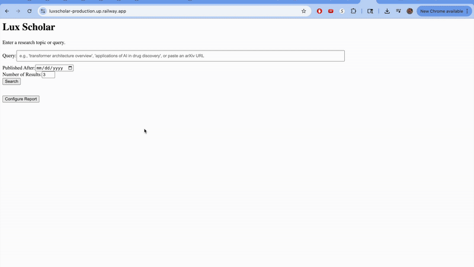

# Office Hours


A web-based research paper assistant for searching academic papers, extracting full text, generating AI reports, chatting with paper-grounded context, creating notes/blog drafts, and exporting reports to Notion.

The app is built with FastAPI, FastHTML/PyHTML, HTMX/SSE, Exa, multiple LLM providers, Postgres-backed private-beta persistence, local disk caches, SQLite metadata caching, LanceDB vector indexes, and optional per-user Notion export.

## Project Setup

1. **Clone the repository (if you haven't already).**
2. **Create Environment File:** Copy `.env.example` to `.env` and fill in your API keys and other configuration details:

   ```bash
   cp .env.example .env
   ```

   Then edit `.env` with your actual credentials.
3. **Install Docker and Docker Compose:** Ensure you have Docker and Docker Compose installed on your system.
4. **Build and Run with Docker Compose:**

   ```bash
   docker-compose up --build
   ```

   This command will build the Docker image for the web application and start the `web` service.

5. **Access the Application:** Open your web browser and go to [http://localhost:8000](http://localhost:8000) (or the port specified in your `.env` file).

## Local Development

If you want to run the app directly without Docker:

1. **Create a virtual environment:**

   ```bash
   python -m venv venv
   source venv/bin/activate  # On Windows use `venv\Scripts\activate`
   ```

2. **Install dependencies:**

   ```bash
   pip install -r requirements.txt
   ```

3. **Ensure `.env` file is present and configured in the project root.**
4. **Run the application:**

   ```bash
   ./dev.sh
   ```

## Private Beta Setup

The app can still run in local demo mode with no database. For multi-user beta mode:

1. Provision Postgres and set `DATABASE_URL`.
2. Generate `OH_SECRET_ENCRYPTION_KEY`:

   ```bash
   python -c "from cryptography.fernet import Fernet; print(Fernet.generate_key().decode())"
   ```

3. Configure Google OAuth with callback `${AUTH_REDIRECT_BASE_URL}/auth/google/callback`.
4. Configure public Notion OAuth with callback `${AUTH_REDIRECT_BASE_URL}/integrations/notion/callback`.
5. Run migrations:

   ```bash
   alembic upgrade head
   ```

6. Set `REQUIRE_LOGIN=1` when you want search/report/chat routes gated to signed-in beta users.

In development, tables are also created automatically when `DATABASE_URL` is set and `ENV != prod`; use Alembic for production.

## Demo



## Project Structure

* `src/main.py`: FastAPI application bootstrap, service initialization, middleware, and router registration.
* `src/config.py`: Application configuration, loads from `.env` in development.
* `requirements.txt`: Python dependencies.
* `Dockerfile`: Defines the Docker image for the web app.
* `docker-compose.yml`: Runs the web app locally.
* `.env.example`: Template for environment variables.
* `src/api/`: FastAPI route modules for search, reports, chat, auth, history, integrations, admin, metadata, and export flows.
* `src/pages/`: PyHTML components for web pages and reusable UI blocks.
* `src/services/`: Backend business logic for Exa, LLMs, text extraction, RAG, reports, chat, notes, auth, persistence, and Notion.
* `src/models/`: Pydantic data models.
* `static/`: Static files (CSS, JavaScript, images).
* `src/templates/`: Reusable PyHTML layout components.
* `src/utils/`: Helper functions and observability utilities.
* `tests/`: Test suite.
* `scripts/`: Utility scripts for cache management, indexing, extraction checks, and QA.

## Development Notes

* The application uses FastAPI for routing, FastHTML for server-rendered components, and HTMX/SSE for dynamic UI updates.
* Full-text extraction and RAG indexes are cached locally under `data/` and `.cache/`.
* Ensure your `.env` file is configured with `EXA_API_KEY` and at least one LLM provider key.
* **Pre-commit** hooks: after cloning, run `pre-commit install` to auto-format & lint each commit.
