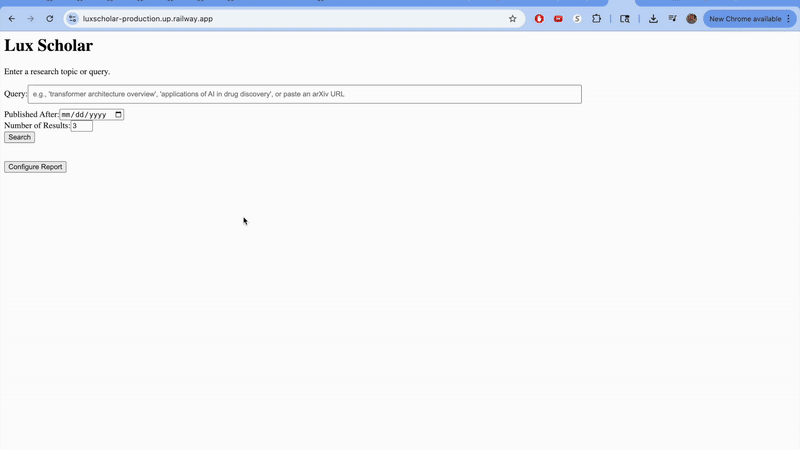

# Office Hours


A research paper assistant. Search the literature, read the full text, generate cited reports, chat with a paper's content, and organize everything into topic pages. Optional Notion sync mirrors papers, topics, and reports into a workspace and answers comments there.

## Demo



## Stack

- FastAPI + FastHTML server-rendered UI, HTMX/SSE for dynamic updates
- Exa for paper search; Semantic Scholar and OpenAlex for author metadata
- LLM calls routed through Gemini, Anthropic, OpenAI, Together, xAI, or OpenRouter
- Postgres via SQLAlchemy + Alembic for accounts and the library; runs without a database in demo mode
- LanceDB + sentence-transformers for embeddings and retrieval
- Notion API for the optional workspace sync

## Setup

Required env vars: `EXA_API_KEY` and `OPENROUTER_API_KEY` (the default model tiers all route through OpenRouter; other provider keys are only needed if you override the models). For demo mode, comment out the placeholder `DATABASE_URL` that `.env.example` ships. The full list is in `.env.example`.

### Docker

```bash
cp .env.example .env   # fill in keys
docker-compose up --build
```

The app is on http://localhost:8000.

### Local dev

Manim needs Cairo, Pango and pkg-config at build time. On Ubuntu or Debian, install them with `sudo apt-get install libcairo2-dev libpango1.0-dev pkg-config ffmpeg fonts-dejavu-core` before syncing Python dependencies.

```bash
uv sync --extra dev    # or: python -m venv .venv && .venv/bin/pip install .
cp .env.example .env
./dev.sh               # uvicorn on $PORT, default 8000
```

Run `uv tool install pre-commit && pre-commit install` after cloning to get the ruff/black/mypy hooks (`pip install pre-commit` works too).

### Saved-paper videos

Open **Library → Visual lesson**, optionally enter a question, and select **Make video**. **Plan scenes** opens the same plan for editing before rendering. The director reads the selected PDF pages and uses recent questions on that paper for guidance when the field is blank. It works out an answer from the source text, plans the animation using the pages and figures, and reviews rendered frames before recording the narration. The worker renders validated Manim panel descriptions and embeds English captions in the MP4.

The default director uses the Standard model on OpenRouter. For an operator-hosted vision model, set `LESSON_PLANNER_URL` to its OpenAI-compatible chat completions endpoint and `LESSON_PLANNER_MODEL` to its model ID. The endpoint must support image inputs and JSON schema responses. For ElevenLabs Brian narration, configure `ELEVENLABS_API_KEY` or point `ELEVENLABS_API_KEY_FILE` at a mounted secret. Without either setting the renderer uses the system voice.

### Persistence and multi-user mode

Without `DATABASE_URL` the app runs in single-user demo mode (note `.env.example` sets a placeholder value, so clear or comment it if you want demo mode). To enable accounts and the saved library:

1. Set `DATABASE_URL` (Postgres) and `OH_SECRET_ENCRYPTION_KEY`:
   `python -c "from cryptography.fernet import Fernet; print(Fernet.generate_key().decode())"`
2. Configure Google OAuth with callback `${AUTH_REDIRECT_BASE_URL}/auth/google/callback`.
3. Optionally configure Notion OAuth with callback `${AUTH_REDIRECT_BASE_URL}/integrations/notion/callback`.
4. `alembic upgrade head`
5. `REQUIRE_LOGIN=1` to gate routes to signed-in users.

## Deployment

Runs on Railway. The Dockerfile CMD runs migrations then serves uvicorn (`alembic upgrade head && uvicorn main:app --port $PORT`). Attach a custom domain under the service's Settings → Public Networking.

## Tests

```bash
pytest
```

`tests/unit` covers services, `tests/e2e` covers the query router with providers stubbed.
