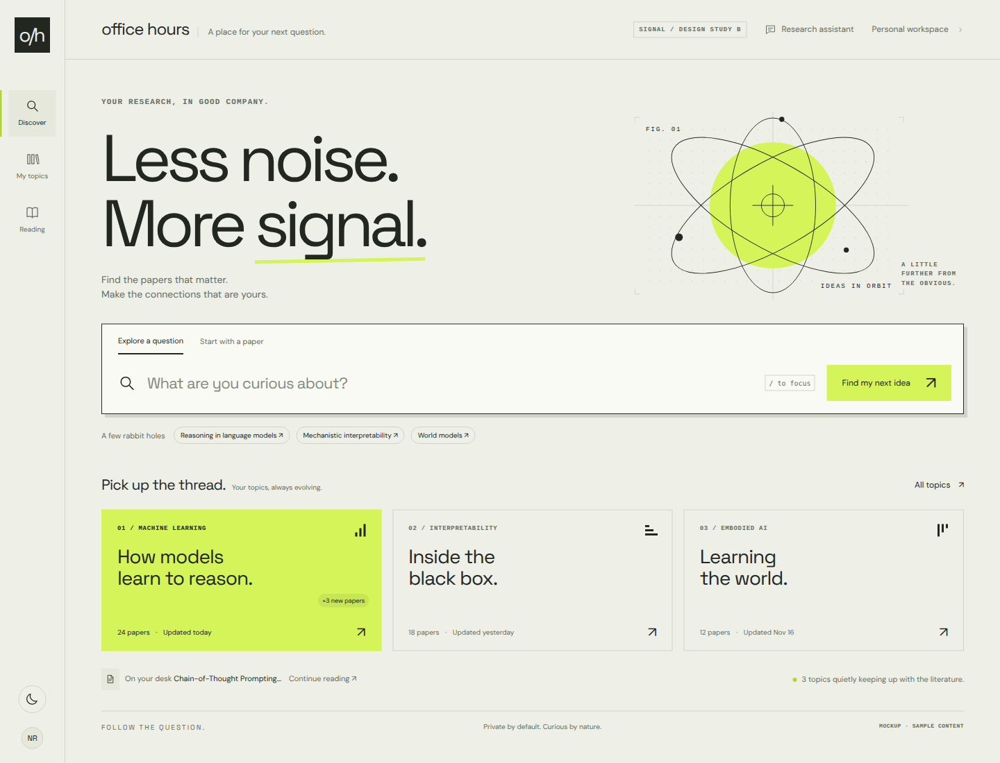
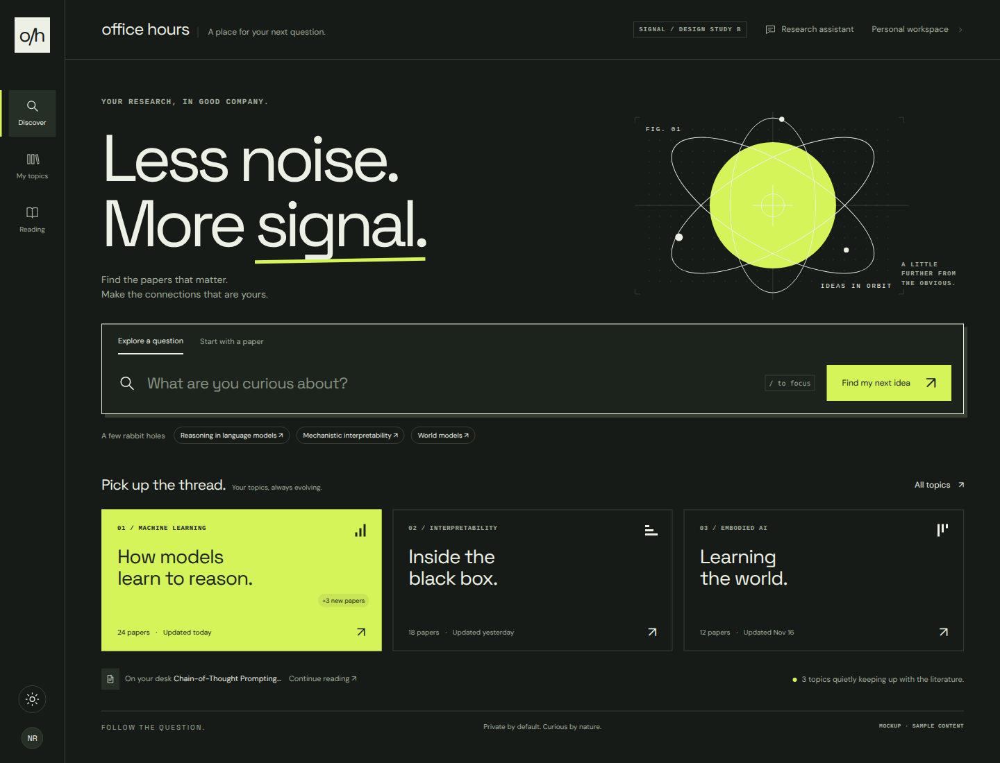
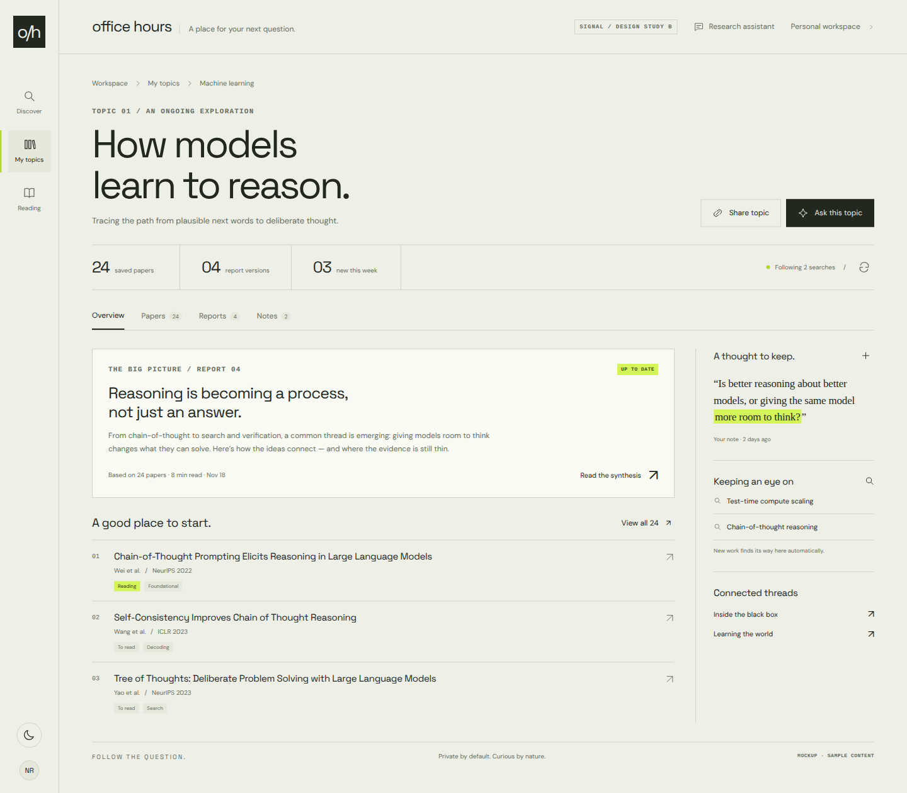
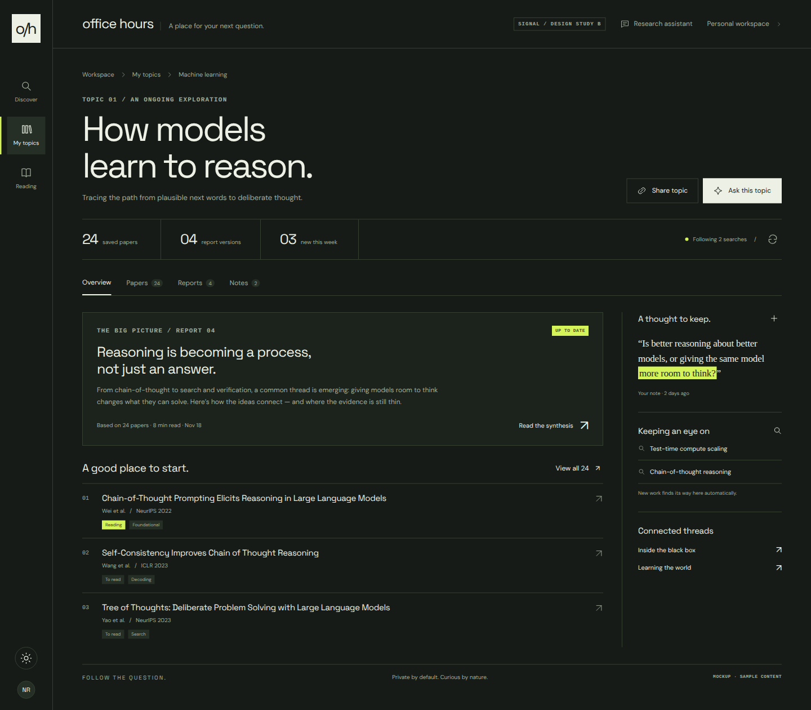
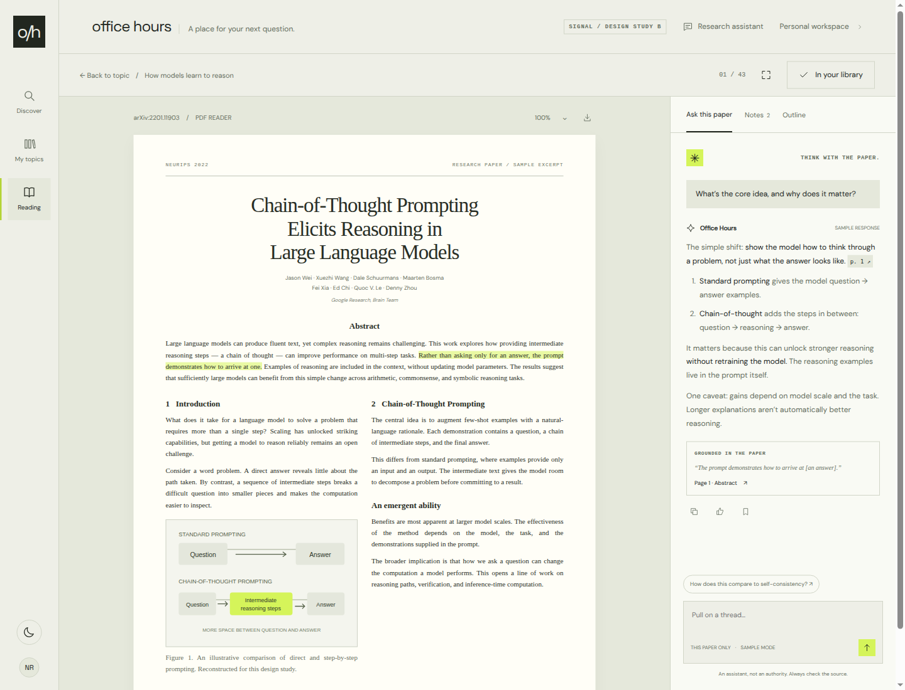
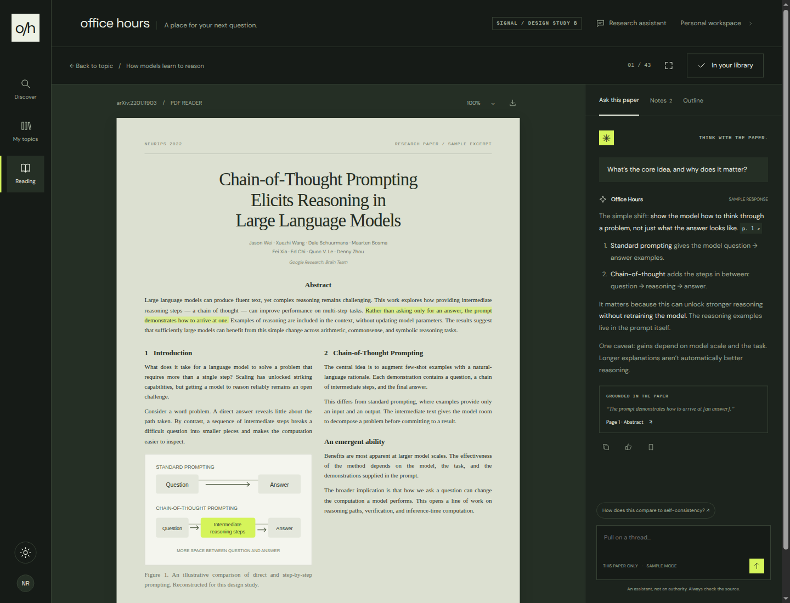
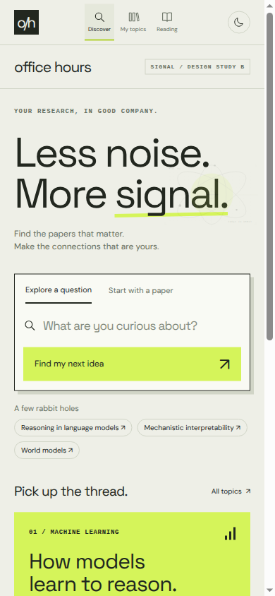
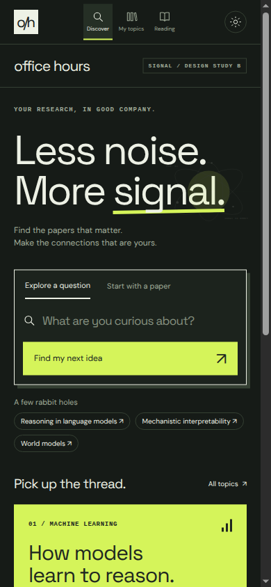

# SIGNAL — Office Hours, look B

A deliberately bold, graphic direction: acid-chartreuse highlights, oversized Space Grotesk typography, orbital research imagery, and a quiet reading surface. A slim, labeled navigation rail leaves the workspace to the research. The home leads with discovery; the topic gives the synthesis priority over the inventory; the reader keeps source and assistant side by side.

This is an **isolated visual prototype**, not a production redesign. No application routes, production assets, database, authentication, or AI integrations are changed. Every count, topic, synthesis, note, and assistant reply is sample content. The paper excerpt is reconstructed for the mockup, not a faithful rendering of the original PDF. The original paper is [Wei et al., 2022](https://arxiv.org/abs/2201.11903).

## Preview locally

From the repository root:

```sh
python -m http.server 8092 --directory docs/look-b
```

Open `http://localhost:8092/?theme=light#home`. Routes are `#home`, `#topic`, and `#reader`; themes are `?theme=light` and `?theme=dark`. All assets are local; no keys, installs, or network calls are needed.

Run the dependency-free template smoke tests with `node --test docs/look-b/check.test.mjs` (Node 18+).

## What is interactive

- The navigation rail connects all three pages.
- The theme switch persists a preference and updates the preview URL.
- Search, topic suggestions, and topic cards lead to a seeded topic.
- Topic tabs expose papers, a sample report, and notes.
- Reader tabs, citation links, library toggle, and follow-up composer work locally.
- Other controls explain their prototype-only scope; no real work is implied.

Layouts adapt down to narrow phone widths, with source and assistant stacked. The document page remains a pale reading surface in the night theme to preserve the feeling of a paper on a dark desk.

Interactions are ephemeral: changing theme or reader tabs restores the seeded conversation. No user state is saved beyond the theme preference.

## Screenshots

Desktop views are 1440 px wide. The topic uses a taller viewport to include its footer; the reader shows the source and assistant at the top of the document.

| Page | Light | Dark |
| --- | --- | --- |
| Home |  |  |
| Topic |  |  |
| Reader |  |  |
| Mobile home |  |  |

## Fonts

Locally bundled Space Grotesk and DM Sans from Google Fonts, both distributed under the SIL Open Font License. Licenses are included in `assets/`.
